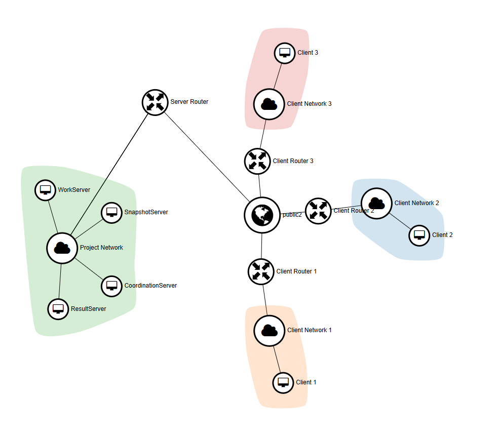
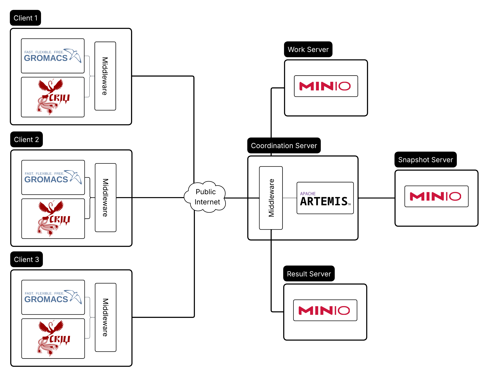

**รหัสโครงงาน:** 68-1_01_kdc-r1

**ชื่อโครงงาน (ไทย):** การประยุกต์ใช้ CHECKPOINT/RESTORE ด้วย CRIU สำหรับระบบการประมวลผลแบบจำลองโมเลกุลแบบกระจาย

**Project Title (Eng):** APPLICATION OF CHECKPOINT/RESTORE USING CRIU FOR DISTRIBUTED MOLECULAR SIMULATION SYSTEMS

**อาจารย์ที่ปรึกษาโครงงาน:** ผศ.ดร กษิดิศ ชาญเชี่ยว 

**ผู้จัดทำโครงงาน:** นายณัฐนันต์ โพธิ์ประดิษฐ์  6509611452  natanan.pho@dome.tu.ac.th

---

# Directory Structure

โครงสร้างของโฟลเดอร์โปรเจค ประกอบด้วย:

1. **Clients**: โฟลเดอร์ที่เก็บ Source Code ของ Client Middleware พัฒนาด้วยภาษา C++ ทำหน้าที่รันโปรแกรมจำลองโมเลกุล (GROMACS)
2. **CoordinationServer**: โฟลเดอร์ที่เก็บ Source Code ของ Coordination Server Middleware พัฒนาด้วยภาษา C++ ทำหน้าที่ คอยจ่ายงานและประสานงานระหว่าง Client และ Storage Servers ในการจัดเก็บทรัพยากรต่าง ๆ ของการประมวลผล
3. **Resources**: โฟลเดอร์ที่เก็บภาพแผนผังการออกแบบระบบ (Network และ System Architecture) และไฟล์ตัวอย่างในการตั้งค่า Artemis Message Broker
4. **demo**: โฟลเดอร์เก็บลิงก์ดาวน์โหลดวิดีโอสาธิตการ Setup และการทำงานของระบบประมวลผลแบบจำลองโมเลกุลแบบกระจาย
5. **final_reports**: โฟลเดอร์ที่เก็บไฟล์รายงานโครงงานและบทคัดย่อโครงงาน
6. **README.md**: ไฟล์คำอธิบายหลักของโครงงาน ทั้งโครงสร้างของระบบ การ Setup และขั้นตอนการใช้งาน

---

# System Architecture



ระบบประมวลผลแบบจำลองโมเลกุลแบบกระจายนี้ มีการทำงานร่วมกันระหว่าง Server และ Clients ผ่าน Public Internet ดังแผนภาพสถาปัตยกรรมระบบ:



### 1. Server
กลุ่มเซิร์ฟเวอร์หลักจะทำงานอยู่ภายใต้เครือข่ายภายใน และมีเพียง Coordination Server ที่จะติดต่อกับ Client ภายนอกเพื่อทำหน้าที่จัดการระบบ ประสานงาน และจัดเก็บข้อมูล
* **Coordination Server:** เป็นศูนย์กลางประสานงานและการควบคุม ประกอบด้วย:
  * **WorkManager (Middleware):** ทำหน้าที่เป็นตัวกลางในการมอบหมายงาน ควบคุมสถานะ และส่งต่องานประมวลผล
  * **Apache Artemis (Message Broker):** ทำหน้าที่จัดการคิวงาน (Message Queue) ประกอบด้วย `WorkQueue` (คิวสำหรับงานประมวลผล) และ `SnapshotQueue` (คิวสำหรับงานที่มีสถานะการ Checkpoint ล่าสุด)
* **Storage Server:** ทำหน้าที่เป็นตัวกลางในการจัดเก็บไฟล์ต่างๆ ได้แก่
  * **Work Server:** ทำหน้าที่เก็บไฟล์โครงสร้างโมเลกุลต้นฉบับ (GROMACS Topology: `.tpr` files)
  * **Snapshot Server:** ทำหน้าที่เก็บไฟล์ Snapshot ที่สร้างขึ้นโดย CRIU จากเครื่องฝั่ง Client
  * **Result Server:** ทำหน้าที่จัดเก็บผลลัพธ์สุดท้ายของการประมวลผลที่ประมวลผลเสร็จสมบูรณ์จากเครื่องฝั่ง Client

### 2. Clients (กลุ่มเครื่องประมวลผล)

Client เป็นเครื่องคอมพิวเตอร์จำนวนหนึ่งภายในระบบการประมวลผลแบบกระจาย ซึ่งไม่จำเป็นจะต้องอยู่ภายใน Network เดียวกันและการสื่อสารระหว่าง Client และ Server จะสื่อสารกันผ่าน Public Network

## ขั้นตอนการทำงาน:
1. **การรันการทำงานของ Coordination Server:**
   * เริ่มต้นการทำงานของ Coordination Server โดยการเปิด Apache Artemis และ Middleware
2. **การเตรียมและมอบหมายงาน:**
   * ผู้ดูแลระบบเพิ่มงานด้วย `http://[IP_ADDRESS]/upload_work?name=[work_name]` (ไฟล์ .tpr ที่มีอยู่ใน WorkManager/gromacs-topology ภายใน Coordination Server เช่น benchMEM)
3. **การดึงงานและประมวลผล:**
   * Client แต่ละเครื่องจะส่งคำขอดึงงานผ่านอินเตอเน็ตมาที่ `CoordinationServer` เพื่อขอรับไฟล์ Topology `.tpr` มาประมวลผล
4. **การทำ Checkpoint/Restore ด้วย CRIU:**
   * เมื่อ Client หยุดโปรแกรม Middleware ภายใน Client จะบันทึกและส่ง Snapshot ไปยัง Server เพื่อให้ Client อื่นทำต่อได้
   * ในช่วงระหว่างการประมวลผล Middleware ของ Client จะส่ง Snapshot ไปยัง Server เป็นระยะๆ เพื่อให้ Client อื่นสามารถทำต่อได้หากเกิดเหตุการณ์ไม่คาดคิด
4. **การส่งผลลัพธ์สุดท้าย (Result Submission):**
   * เมื่อจำลองโมเลกุลจนสิ้นสุดขั้นตอนสำเร็จแล้ว ไคลเอนต์จะอัปโหลดผลลัพธ์สมบูรณ์ไปยัง Server

# Server Setup


> **หมายเหตุ (Note):** เซิร์ฟเวอร์ที่ใช้ในการทดลองของโครงงานนี้ถูกติดตั้งและทำงานอยู่บน virtual instances ใน private network จึงไม่สามารถเปิดให้เข้าถึงผ่าน public network ได้ หากต้องการสร้างและตั้งค่าระบบด้วยตนเอง สามารถปฏิบัติตามคำแนะนำและขั้นตอนการติดตั้งดังด้านล่างนี้ได้


## Part 1: Storge Server Setup Guide

ขั้นตอนนี้จะเป็นการอธิบายการ Setup และ Config Storage Server โดยจะติดตั้งโปรแกรม MinIO ภายใน WorkServer, SnapshotServer และ ResultServer เพื่อทำหน้าที่เป็น Storage Servers

*หมายเหตุ: งานวิจัยนี้ได้ทดสอบบน Ubuntu Server 24.04 เท่านั้น สำหรับ Version หรือ Platform อื่นอาจมีการติดตั้งที่ต่างออกไป*

---

### System Architecture

Storage Servers ทั้ง 3 ส่วนจะมีหน้าที่ดังนี้

| Server Type | Bucket Name | Purpose |
| :--- | :--- | :--- |
| **Work Server** | `gromacs-topology` | จัดเก็ยไฟล์ Topology (.tpr) ต้นฉบับ |
| **Snapshot Server** | `snapshot` | จัดเก็บ Snapshot |
| **Result Server** | `results` | จัดเก็บผลลัพธ์การประมวลผล |

*หมายเหตุ: ตามขั้นตอนดังต่อไปนี้ เป็นการติดตั้ง MinIO สำหรับทั้ง 3 Storage Servers*

MinIO AIStor Documentation: https://docs.min.io/aistor/


### 1. Installation

```bash
# ดาวน์โหลดแหละติดตั้ง MinIO
curl --progress-bar -L dl.min.io/aistor/minio/release/linux-amd64/minio.deb -o minio.deb
sudo dpkg -i minio.deb
minio --version
```

### 2. License & Configuration

MinIO จำเป็นต้องใช้ License ในการใช้งาน ซึ่งสามารถดาวน์โหลดได้ที่ https://subnet.min.io/ 

```bash
# สร้าง license directory
sudo mkdir -p /opt/minio
sudo nano /opt/minio/minio.license
# วาง license ที่ได้จาก https://subnet.min.io/
```

### 3. Configuration
```bash
sudo nano /etc/default/minio
```
วางค่าเหล่านี้ อ้างอิงได้จาก [MinIO AIStor Documentation](https://docs.min.io/aistor/)

```bash
MINIO_LICENSE="/opt/minio/minio.license"
MINIO_VOLUMES="/mnt/drive-1/minio"
```

กำหนดสิทธิ์และเริ่มการทำงาน

```bash
# กำหนด permission ที่ Config folder
sudo chown -R minio-user:minio-user /opt/minio

# กำหนดให้ MinIO service เริ่มทำงานเองเมื่อเปิดเครื่อง
sudo systemctl enable minio.service
# เริ่มการทำงานของ MinIO service
sudo systemctl start minio.service
```

### 4. Create Buckets
ไปยัง Console `http://[Server-IP]:9001` ของทั้ง 3 Storage Servers และสร้าง Bucket ดังต่อไปนี้:
- `gromacs-topology` สำหรับ Work Server
- `snapshot` สำหรับ Snapshot Server
- `results` สำหรับ Result Server

*สำหรับ default credential ของ console คือ `minioadmin` / `minioadmin`

### 5. Generate Access Keys

สร้าง Access Key สำหรับทั้ง 3 Storage Servers เพื่อใช้กำหนด Environment Variable ภายใน Coordination Server ที่ประกอบไปด้วย
```bash
WORKSERVER_URL
WORKSERVER_ACCESSKEY
WORKSERVER_SECRETKEY

SNAPSHOTSERVER_URL
SNAPSHOTSERVER_ACCESSKEY
SNAPSHOTSERVER_SECRETKEY

RESULTSERVER_URL
RESULTSERVER_ACCESSKEY
RESULTSERVER_SECRETKEY
```
---


## Part 2: Coordination Server Setup Guide

ขั้นตอนนี้เป็นการติดตั้ง Middleware บน Coordination Server ซึ่งประกอบไปด้วย: **Apache Artemis** message broker และ **WorkManager** Middleware สำหรับ Coordination Server.

*หมายเหตุ: งานวิจัยนี้ได้ทดสอบบน Ubuntu Server 24.04 เท่านั้น สำหรับ Version หรือ Platform อื่นอาจมีการติดตั้งที่ต่างออกไป*

### Apache Artemis Setup

Apache Artemis ทำหน้าที่เป็นตัวจัดการคิวงานการประมวลผลแบบจำลองโมเลกุลและงานที่เป็น Snapshot.

### 1. Installation

Setup สภาพแวดล้อมและติดตั้ง Apache Artemis 2.54.0 [Official Website](https://artemis.apache.org/components/artemis/download/)

```bash
# ติดตั้ง dependency
sudo apt update
sudo apt install nano openjdk-21-jdk -y # Apache Artemis 2.54.0 ใช้ Java 17 ขึ้นไป

# ดาวน์โหลด Apache Artemis 2.54.0
wget -O apache-artemis-2.54.0-bin.tar.gz "https://www.apache.org/dyn/closer.lua?filename=artemis/artemis/2.54.0/apache-artemis-2.54.0-bin.tar.gz&action=download"

# แตกไฟล์ Apache Artemis 2.54.0
tar -xzf apache-artemis-2.54.0-bin.tar.gz

# สร้าง Broker Instance (ในที่นี้ชื่อ mybroker)
sudo apache-artemis-2.54.0/bin/artemis create /var/lib/mybroker
```

### 2. Configuration

แก้ไขไฟล์ Config ใน `/var/lib/mybroker/etc/`:

สามารถดูตัวอย่างไฟล์ Config ได้ใน Folder 'Resources/artemis'.

#### `broker.xml`
- ภายใน `<address-settings>` ชี้ปลายทาง Expire ของ Snapshot Queue ไปยัง WorkQueue กำหนด min-expiry-delay เป็น 0 และ max-expiry-delay เป็น 240000 (4 นาที) เพื่อให้ Snapshot Queue มีอายุการรอข้อความไม่เกิน 4 นาที
```bash
<address-setting match="SnapshotQueue">
    <expiry-address>WorkQueue</expiry-address>
    <min-expiry-delay>0</min-expiry-delay>
    <max-expiry-delay>240000</max-expiry-delay>
</address-setting>
```

- ภายใน `<addresses>` เพิ่ม Work Queue และ Snapshot Queue และกำหนด last value เป็น true เพื่อให้ Snapshot Queue เก็บเฉพาะข้อมูล Snapshot Job ล่าสุดเท่านั้น
```bash
<address name="WorkQueue">
        <anycast>
            <queue name="WorkQueue" last-value="true"/>
        </anycast>
</address>
<address name="SnapshotQueue">
        <anycast>
            <queue name="SnapshotQueue" last-value="true"/>
        </anycast>
</address>
```

#### `bootstrap.xml`
- ภายใน `<web>` กำหนด `http://0.0.0.0:8161` เพื่อให้สามารถเข้าถึง management console ได้จากภายนอก
```bash
<web>...
  <binding name="artemis" uri="http://0.0.0.0:8161">
  ...
</web>
```

#### `jolokia-access.xml`
- ภายใน `<cors>` กำหนด 
`<allow-origin>*://0.0.0.0*</allow-origin>` และ `<allow-origin>*<allow-origin>`
- ภายใน `<policies>` กำหนด `<ignore-scheme/>`

### 3. Service Management

```bash
# เริ่มการทำงานของ Artemis broker
sudo /var/lib/mybroker/bin/artemis-service start

# ตั้งค่าให้เปิดทำงานตอนเปิดเครื่อง
sudo systemctl enable /var/lib/mybroker/bin/artemis-service
```

---

## Part 3: WorkManager Build & Configuration

### 1. Build Prerequisites

- **C++20 Compiler**
```bash
sudo apt install build-essential -y
```
- **CMake (>= 4.1):** [Official Installation Guide](https://cmake.org/download/).
```bash
sudo snap install cmake --classic
```
- **vcpkg:** [Getting Started with vcpkg](https://learn.microsoft.com/en-us/vcpkg/get_started/get-started).
```bash
git clone https://github.com/microsoft/vcpkg.git ${HOME}/vcpkg
${HOME}/vcpkg/bootstrap-vcpkg.sh
find ${HOME}/vcpkg -name "vcpkg.cmake" # for vcpkg.cmake path

sudo apt install autoconf autoconf-archive automake libtool # required for activemq-cpp vcpkg package
```
- **mold Linker:**
  ```bash
  sudo apt install mold -y
  ```


### 2. Build Instructions

- สามารถทำการ build โปรเจคได้โดยตรงจาก IDE ที่มีการติดตั้ง `cmake` และ `vcpkg` หรือหากใช้ CLI ล้วนสามารถใช้คำสั่ง `cmake` ใน root directory WorkManager

```bash
cmake -S . -B build -DCMAKE_TOOLCHAIN_FILE=<vcpkg_root_path>/scripts/buildsystems/vcpkg.cmake
cmake --build build --target WorkManager --clean-first -j
```
*แทนที่ `<vcpkg_root_path>` ด้วย Path ที่ติดตั้ง vcpkg*

### 3. Environment Variables

*หมายเหตุ: สำหรับ WorkManager จะไม่ใช้การสร้างไฟล์ `.env` แต่ให้ใช้วิธีการกำหนดค่า Environment Variables ลงใน Terminal ก่อนที่จะเริ่มรันโปรแกรม*

ตัวอย่างการกำหนดค่าใน Terminal:
```bash
export WORKQUEUE_URL="tcp://[IP_ADDRESS]:[Port]"
export WORKSERVER_URL="http://[IP_ADDRESS]:[Port]"
...
# set all variable before start the program
```

กำหนดค่า Environment Variables ทั้งหมดดังนี้ (สามารถดูรูปแบบตัวแปรได้จากไฟล์ตัวอย่าง [CoordinationServer/WorkManager/.env.example](CoordinationServer/WorkManager/.env.example)):


| Variable | Description |
|---|---|
| `WORKQUEUE_URL` | Artemis Broker URI (เช่น `tcp://[IP_ADDRESS]:[Port]`) |
| `WORKSERVER_URL` | MinIO Work Server URL (เช่น `tcp://[IP_ADDRESS]:[Port]`) |
| `WORKSERVER_ACCESSKEY` | MinIO Work Server Access Key |
| `WORKSERVER_SECRETKEY` | MinIO Work Server Secret Key |
| `SNAPSHOTSERVER_URL` | MinIO Snapshot Server URL (เช่น `tcp://[IP_ADDRESS]:[Port]`) |
| `SNAPSHOTSERVER_ACCESSKEY` | MinIO Snapshot Server Access Key |
| `SNAPSHOTSERVER_SECRETKEY` | MinIO Snapshot Server Secret Key |
| `RESULTSERVER_URL` | MinIO Result Server URL (เช่น `tcp://[IP_ADDRESS]:[Port]`) |
| `RESULTSERVER_ACCESSKEY` | MinIO Result Server Access Key |
| `RESULTSERVER_SECRETKEY` | MinIO Result Server Secret Key |

### 4. Important Paths

- **GROMACS Topologies:** ในโปรเจคจะเป็นการทดลองใช้ api `http://[IP_ADDRESS]/upload_work?name=[work_name]` ในการคัดลอกงาน `work_name` ที่เป็น `.tpr` จาก `/gromacs-topology` เพื่อเพิ่มงานไปยัง Work Server และ Work Queue ดังนั้นให้ทำงานวางงานที่ต้องการ (ในงานวิจัยใช้ไฟล์ตัวอย่างจาก [Max Planck Institute for Multidisciplinary Sciences](https://www.mpinat.mpg.de/grubmueller/bench))
- **Temporary Storage:** ระบบจะใช้ `/tmp/` สำหรับการบัฟเฟอร์ระหว่างการส่งข้อมูล

### 5. Run Instructions

```bash
./build/WorkManager
```

Coordination Server จะทำการเปิด Port 65096 และรันอยู่ตลอดเวลา เพื่อรอรับ Request ต่าง ๆ จาก Client

*Middleware เป็นการรันในรูปแบบของ CLI เป็นหลัก*

# Clients Setup

*งานวิจัยนี้ได้ทดสอบบน Ubuntu Server 24.04 เท่านั้น สำหรับ Version หรือ Platform อื่นอาจมีการติดตั้งที่ต่างออกไป*

## 1. Build Prerequisites
- **C++20 Compiler**
```bash
sudo apt install build-essential -y
```
- **CMake (>= 4.1):** [Official Installation Guide](https://cmake.org/download/).
```bash
sudo snap install cmake --classic
```
- **vcpkg:** [Getting Started with vcpkg](https://learn.microsoft.com/en-us/vcpkg/get_started/get-started).
```bash
git clone https://github.com/microsoft/vcpkg.git ${HOME}/vcpkg
${HOME}/vcpkg/bootstrap-vcpkg.sh
find ${HOME}/vcpkg -name "vcpkg.cmake" # for vcpkg.cmake path

sudo apt install autoconf autoconf-archive automake libtool # required for activemq-cpp vcpkg package
```
- **mold Linker:**
  ```bash
  sudo apt install mold -y
  ```

- **GROMACS** [Official Installation Guide](https://manual.gromacs.org/2026.2/install-guide/index.html)
- **CRIU** [Official Installation Guide](https://criu.org/Installation)
- **pigz**
  ```bash
  sudo apt install pigz -y
  ```

## 2. Build Instructions

- สามารถทำการ build โปรเจคได้โดยตรงจาก IDE ที่มีการติดตั้ง `cmake` และ `vcpkg` หรือหากใช้ CLI ล้วนสามารถใช้คำสั่ง `cmake` ใน root directory WorkManager

```bash
cmake -S . -B build -DCMAKE_TOOLCHAIN_FILE=<vcpkg_root_path>/scripts/buildsystems/vcpkg.cmake
cmake --build build --target my_app --clean-first -j
```
*แทนที่ `<vcpkg_root_path>` ด้วย Path ที่ติดตั้ง vcpkg*

## 3. Environment Variables

ในการรัน Client (Project2) จำเป็นต้องมีไฟล์ `.env` อยู่ภายในโฟลเดอร์ `Clients/Project2` ซึ่งเก็บค่าคอนฟิกต่าง ๆ ที่โปรแกรมต้องการ โดยสามารถดูตัวอย่างค่าได้จากไฟล์ [Clients/Project2/.env.example](Clients/Project2/.env.example)

รายละเอียดของค่าคอนฟิกในไฟล์ `.env`:
| Variable | Description |
|---|---|
| `ARTEMIS_AUTH` | Username:Password สำหรับ Apache Artemis message broker (เช่น `admin:admin`) |
| `ARTEMIS_GETCOUNT_TARGET` | URL ของ Jolokia สำหรับอ่านจำนวนข้อความใน WorkQueue |
| `ARTEMIS_PORT` | Port สำหรับการเข้าถึง Jolokia console บน Apache Artemis (ค่าเริ่มต้น `8161`) |
| `COORDINATIONSERVER_PORT` | Port สำหรับการเชื่อมต่อไปยัง Coordination Server (ค่าเริ่มต้น `65096`) |
| `COORDINATIONSERVER_URL` | IP Address ของ Coordination Server |
| `GMX_PATH` | Path ที่อยู่ของโปรแกรม GROMACS (`gmx`) บนเครื่อง Client |
| `WORKQUEUE_URL` | URL สำหรับเชื่อมต่อกับ Apache Artemis WorkQueue |

## 4. Run Instructions

```bash
./build/my_app
```
*Middleware เป็นการรันในรูปแบบของ CLI เป็นหลัก*

## 5. Stop & Checkpoint

สามารถส่งสัญญาณ SIGINT หรือ SIGTERM (กด Ctrl+C) เพื่อหยุดการทำงานของโปรแกรม โดย Middleware จะทำการ Checkpoint ส่ง Snapshot ไปยัง Server และหยุดการทำงาน